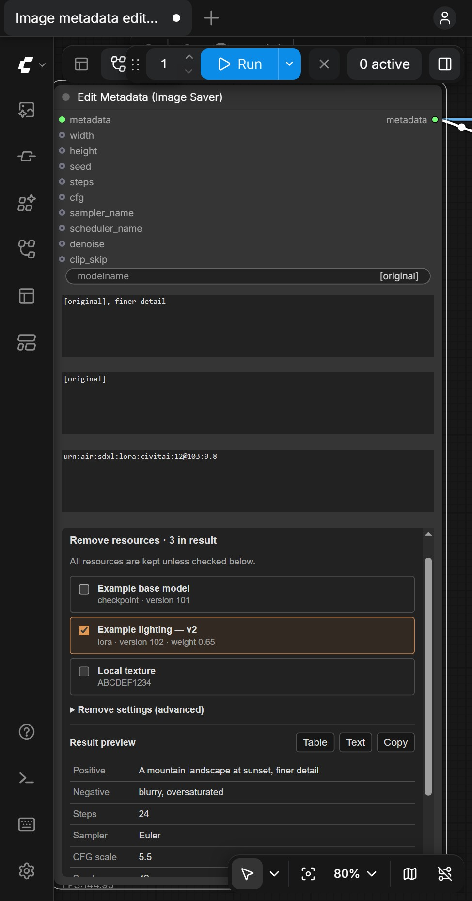
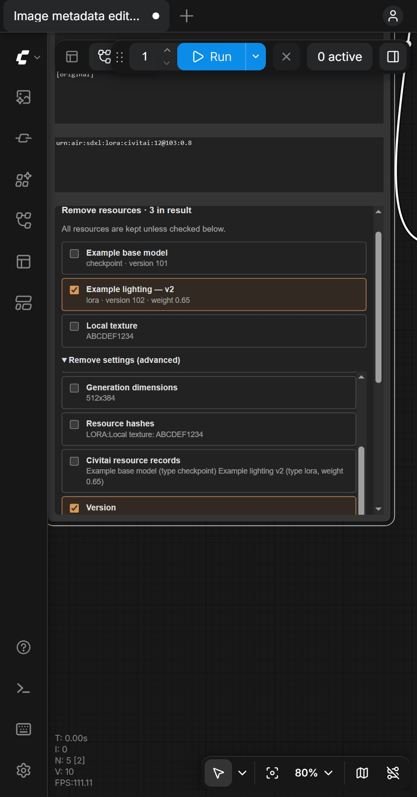

# Image metadata editor prototype

This image-only collaboration branch starts at alexopus/ComfyUI-Image-Saver `load-metadata`, commit `0a8852b`. It keeps the upstream image loader, live metadata display, Metadata dataclass, and targeted editing behavior. It contains no video nodes, FFmpeg integration, or PyAV dependency.

## Changes to review

- **Add resources:** `additional_hashes` merges hashes, Civitai version IDs, AIRs and optional weights. Original references remain; matching identities merge; an explicitly supplied weight updates the resource. The editor does not hash model files or contact Civitai.
- **Select removals:** choose actual source resources by readable name/version and see their identifiers and weights. Settings use a separate advanced checklist with current values. The underlying STRING inputs still accept comma-separated selectors or JSON arrays for API workflows and connected inputs.
- **Preview the result:** the same Python editing function drives both the live preview and workflow execution. File-loader sources, editor chains, reroutes and literal values can be inspected before executing. Values computed by other nodes require execution; the UI identifies that limitation and can show the last executed result.
- **Expand metadata:** Expand Image Saver Metadata exposes individual values and a complete resource-reference string. That string can be connected to `additional_hashes` on the editor or existing metadata builder.

Removal is applied before addition. A reference can therefore be explicitly reintroduced after removal. Hashes and version IDs cannot be correlated offline unless they already share a known identity; the editor never guesses a correspondence.

## Try the example

1. Use this branch in an isolated ComfyUI installation and restart it; refresh the frontend.
2. Copy [`metadata-example.png`](../../examples/metadata-example.png) to ComfyUI's input directory.
3. Load [`image-metadata-editor-example.json`](../../examples/image-metadata-editor-example.json).
4. Inspect the resource checklist and result preview. Run to save the edited image and display the expanded resource references.

The source image and resource names/IDs are demonstration data. This workflow edits metadata and saves the image; it does not run generation or an upscale sampler.

## Screenshots

The following are captures of the running ComfyUI prototype, not mockups.

## Validation

The Python suites cover preserving unedited text, adding/removing references, explicit weight updates, deduplication, complete loader/expander exports, and PNG/JPEG/WebP/AVIF save/reload. JavaScript checks cover editor-chain order, cycles, computed values, and serialized selections.

Manual verification in a separate CPU-only ComfyUI instance covered selecting a resource and setting, adding another resource, executing the workflow, inspecting the saved file, copying the result, and restoring the selections after saving/reloading the workflow.

Two symlink-containment tests require Windows symlink privileges and were excluded from this local run. They remain enabled in Linux CI.
